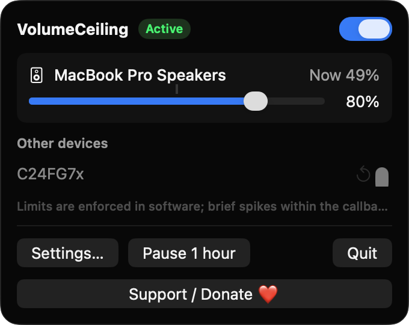
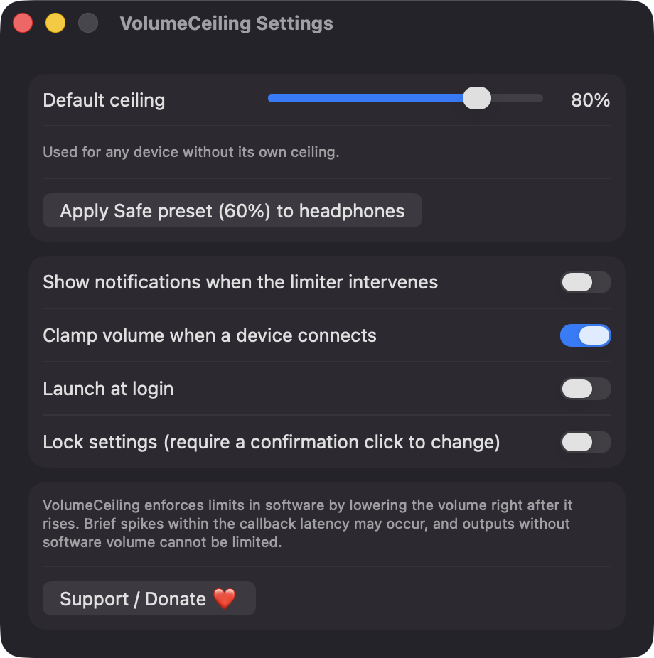
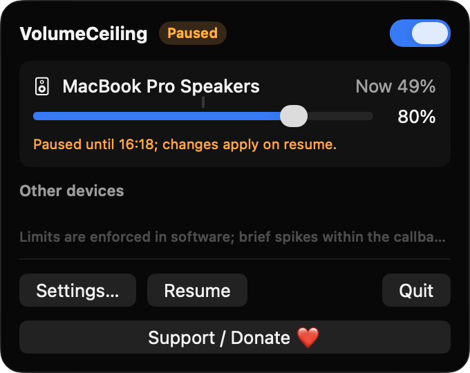

# VolumeCeiling

**🌐 Website:** [turhe123.github.io/volume-ceiling](https://turhe123.github.io/volume-ceiling/)

Set a maximum volume for each output device so headphones can never blast your ears.

> 🆓 A free, open-source **Hear Volume Limiter alternative** for macOS 14+. Native Swift, no accounts, no subscriptions, MIT licensed.

> 🆓 A free, open-source **Hear Volume Limiter alternative** for macOS 14+. Native Swift, no accounts, no subscriptions, MIT licensed.


## Why

VolumeCeiling is a free, open-source, 100% native, backend-free alternative to paid utilities in the *Audio* category. It was inspired by Hear Volume Limiter ($5.99 one-time). It has no accounts, no analytics and no network code. Your limits are stored locally in `UserDefaults`.

## Features

- **Per-device ceilings.** Each output device that has software volume control gets its own ceiling slider (5–100%). Ceilings are stored by the device's unique ID.
- **Default ceiling** (80% out of the box) for any device without its own limit, plus a per-device reset button.
- **Live enforcement.** VolumeCeiling listens to CoreAudio for volume changes on the active output. If the volume goes above the ceiling, it lowers it right away. Short debouncing prevents flicker when you hold the volume keys.
- **Clamp on connect.** When a device connects or becomes the default output, its volume is brought under the ceiling. It returns to the last volume seen for that device, never above the ceiling.
- **Menu bar indicator** showing the state icon (active / paused / off), the current device name and its ceiling.
- **Menu bar window** with the active device, its live volume and a ceiling slider with a tick mark for the current volume. Other known devices, including ones that are not connected, are listed below it.
- **Safe preset.** One click sets 60% on headphone-type devices, detected by name.
- **Master switch** and **Pause for 1 hour**. Pausing resumes automatically and survives a relaunch.
- **Optional settings lock.** Changing limits needs a confirmation click, which unlocks editing for 5 minutes.
- **Optional notifications** when the limiter intervenes (at most one per device every 30 seconds).
- **Launch at login** via `SMAppService`.
- **Honest about unsupported outputs.** Devices with no software volume (some HDMI, DisplayPort or USB DAC outputs) are shown greyed out with a reason instead of being ignored.

> **Limitations:** limits are enforced in software by lowering the volume right after it rises. Brief spikes within the callback latency may occur, and outputs that control volume in hardware cannot be limited.

## Screenshots

<p align="center"></p>

<p align="center"><em>The menu bar window shows the active output device, its live volume and an 80% ceiling slider, with other known devices listed below.</em></p>

<p align="center"></p>

<p align="center"><em>Settings let you choose the default ceiling, apply a 60% safe preset to headphones, and turn on notifications, clamp on connect, launch at login and the settings lock.</em></p>

<p align="center"></p>

<p align="center"><em>Pause for 1 hour suspends the limiter and shows when it will resume automatically.</em></p>

## Install

1. Download `VolumeCeiling-macOS.zip` from the [latest release](https://github.com/turhe123/volume-ceiling/releases/latest).
2. Unzip it and move `VolumeCeiling.app` to `/Applications`.
3. Because the app is open source and not notarized, run:

   ```bash
   xattr -cr /Applications/VolumeCeiling.app
   ```

4. The first time, right-click the app and choose **Open**.

## Build from source

Requires macOS 14+ and Xcode with Swift 5.9+.

```bash
brew install xcodegen
xcodegen generate
xcodebuild -project VolumeCeiling.xcodeproj -scheme VolumeCeiling -configuration Release -derivedDataPath ./build build
```

The app is produced at `build/Build/Products/Release/VolumeCeiling.app`.

## Permissions

VolumeCeiling asks for very little. Based on the source:

- **Accessibility:** not requested.
- **Screen Recording:** not requested.
- **Microphone:** not requested.
- **Volume control:** needs no permission. It uses CoreAudio to read and write device volume.
- **Notifications:** optional. The system prompt appears only the first time you turn on "Show notifications". If you decline, the setting turns itself off.
- **Login item:** optional. It is registered only if you enable "Launch at login", and macOS may show it in System Settings › General › Login Items.

## Support ❤️

If VolumeCeiling saves your ears, you can support development:

[Support Or (Leo) Davidai ❤️](https://ko-fi.com/leodavidai)

The app also has a "Support / Donate ❤️" button.

## More free Mac apps

VolumeCeiling is one of [60 free, open-source Mac utilities](https://github.com/turhe123/mac-apps) built the same way: native Swift, no accounts, no telemetry. Browse the full gallery at [turhe123.github.io/mac-apps](https://turhe123.github.io/mac-apps/).

## License

MIT © Or Davidai Bachar
